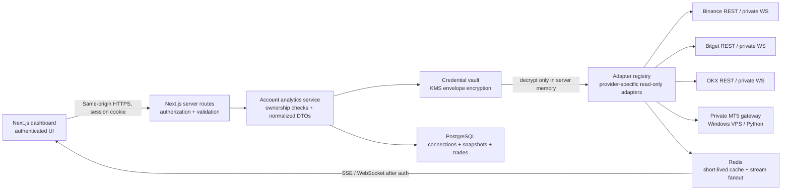

# Exchange analytics architecture (phase 1)

This is the initial architecture and read-only adapter contract. It does **not** connect an exchange or broker, store API credentials, fetch private balances, stream live account data, or submit orders. The running application still uses SQLite for authentication; `database/schema.sql` is a PostgreSQL target schema and must not be mistaken for an applied migration.

## Components and data flow



### Trust boundaries

- The browser receives normalized account data, never provider credentials.
- The server verifies the authenticated user owns each connection before reading/decrypting credentials.
- Raw API keys, secrets, passphrases, MT5 passwords, and gateway tokens must never be logged or stored in browser state. Encrypt credentials with AES-256-GCM data keys protected by a KMS-managed key; persist ciphertext, nonce, authentication tag, key ID, and version only.
- Start with read-only exchange keys; withdrawals and order methods are intentionally absent from phase-1 adapter contracts.
- Place the MT5 gateway on a private network, require mutual authentication and per-user scoped tokens, and expose no unauthenticated public listener.
- Redis is ephemeral and contains only short-lived normalized data; PostgreSQL is the durable source of truth.

## Initial service boundary

Use the existing Next.js App Router for authenticated request handling and UI while integrations remain read-only. Keep provider adapters behind `IExchangeAdapter` so provider SDKs cannot leak into UI code. Run WebSocket consumers and MT5 polling in a separate worker/gateway process when live account streams are introduced; do not hold long-lived streams in serverless route handlers.

```text
app/
  api/accounts/                 authenticated account endpoints (future)
  lib/exchanges/
    adapter.ts                  unified read-only contract and factory context
    errors.ts                   typed provider failures and retry metadata
    registry.ts                 explicit provider adapter registration
    types.ts                    normalized account, balance, position, trade DTOs
database/
  schema.sql                    proposed PostgreSQL schema (not applied)
services/
  mt5-gateway/                   separate private Windows/Python deployment (future)
```

## PostgreSQL data model

`database/schema.sql` defines users, exchange connections, encrypted credential envelopes, account/balance/position snapshots, historical trades, and audit events. Monetary and quantity values use `NUMERIC`, not floating-point. Snapshot tables are append-only so analytics can compare observations over time. Provider trade IDs are unique per connection for safe upserts.

Before applying this schema, migrate the existing SQLite identity model deliberately: this app currently uses TEXT user IDs and SQLite auth, whereas the proposed target uses UUID users. Do not silently mix the two identity stores.

## Adapter contract and error policy

`app/lib/exchanges/adapter.ts` defines normalized read methods and an async account-update stream. Credentials are supplied server-side through `AdapterContext` and must be decrypted only for adapter construction/use. Values representing money, quantities, and prices are decimal strings to avoid JavaScript floating-point loss.

`ExchangeAdapterRegistry` refuses duplicate registrations and throws a typed `PROVIDER_NOT_CONFIGURED` error when no provider adapter is installed. This is intentional: unimplemented integrations must fail explicitly, never return success-shaped placeholder balances or positions. Provider implementations should normalize 429/5xx errors, honor `Retry-After`, use bounded exponential backoff, and support cancellation.

## Phased delivery

1. This phase: architecture, PostgreSQL target schema, typed read-only adapter interface, error model, and registry.
2. Next: migration/identity decision, KMS-backed credential vault, per-user connection lifecycle, and read-only Binance/Bitget/OKX adapters with tests against provider sandbox/mock servers.
3. Separately deploy the authenticated MT5 gateway and implement its adapter.
4. Add worker-managed private streams, Redis fanout, snapshots, and portfolio analytics.
5. A separate Binance Futures Testnet EA is now available; it remains disabled by default and is pinned to Testnet. Live order entry remains out of scope until explicit user approval, stronger authorization, independent controls, immutable audit, comprehensive limits, idempotency/reconciliation, and demo-environment validation. Never add withdrawal capability.
